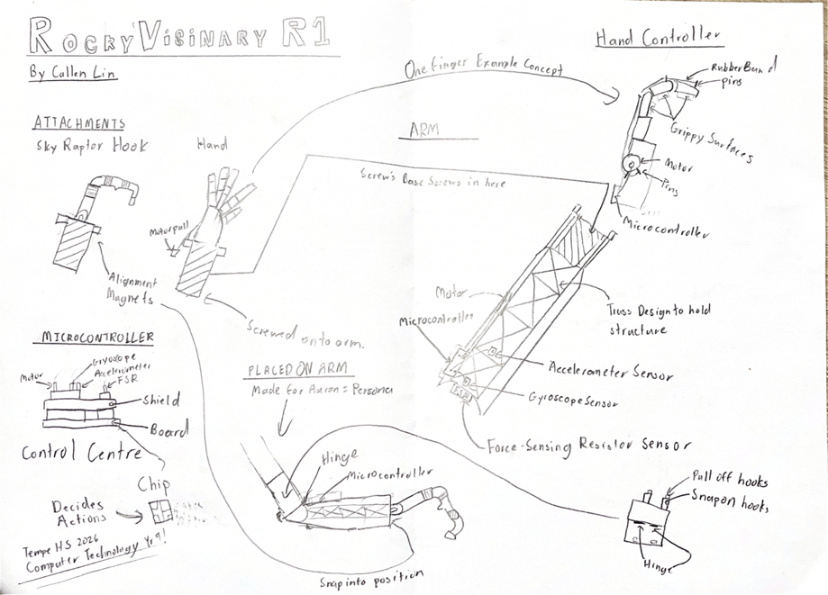

# Biomedical Project

## Project Progress in the Moment

## Task Description
### Design Situation:
Biomedical Engineering is the application of engineering principles to developing technologies and solving problems in a diverse range of healthcare-related fields. Biomedical Mechatronics is a branch of Biomedical Engineering specifically focused on engineering solutions using mechatronic components, including sensors, actuators, and feedback systems managed by processing and control systems.

### Design Brief:
Students will design, document, and prototype a Biomedical device specific to a patient’s biomedical needs and personal requirements.

## Profile of Patient

**Aaron**
Hi, my name is Aaron, and I love to bush walk and rock climb. A few years ago, I was hiking in the Utah Mountains in America when I fell through a crevasse, and a large boulder crushed my arm forearm. Long story short, I now don't have a right arm, making climbing and performing daily activities difficult. Mostly I really miss being able to rock climb.

**What I need is a sports-specific prosthetic so I can climb again!**

If you would like to know more about what I need, please email me Aaron c/o benjamin.jones21@det.nsw.edu.au

**Summary of Medical notes**
- Mid-section trans-radial amputations of the right arm
- Amputations due to trauma beyond repair
- No adherent scar tissue
- Ulnohumeral joint is healthy and articulates normally
- Referring Specialist: Ben Jones - benjamin.jones21@det.nsw.edu.au

Notes: [Aaron's Patient Profile File]([./BioMedical_Mechatronics_Task/Patient_Profiles/Aaron.md](https://github.com/TempeHS/TempeHS_Ardunio_Bootcamp/blob/main/BioMedical_Mechatronics_Task/Patient_Profiles/Aaron.md))

## Overview of Project

> [!TIP]
> The content below is from the Statement of Intent during project, you should take a look at High Level Pictorial and Profile of Patient to quickly understand the goal! :)

RockyVisionary is a biomedical mechanical arm that allows the user to control a prosthetic hand that follows the movement of the elbow. It uses a microcontroller, gyroscope, accelerometer, and motors to detect movement and translate it into controlled actions of the hand. Together, these components aim to create a comfortable and lightweight mechanical arm that responds naturally to the user’s movements.

RockyVisionary is a solution dedicated to Aaron, who envisions a future where he can pursue his passion for rock climbing again. Due to an unfortunate incident that resulted in a trans-radial amputation of his right arm, Aaron is no longer able to rock climb in the same way as before. However, because his elbow joint remains healthy, meaning there is still movement that can be used to help control the prosthetic arm.

Given that Aaron has a trans-radial amputation but still has a healthy elbow joint, RockyVisionary can use a range of sensors to detect the direction and rotation of his remaining arm. This information can then be processed by the microcontroller to determine how the prosthetic hand should respond. By using the movement Aaron still has, the device aims to provide him with a more natural way of controlling the hand and regaining some of the gripping ability required for rock climbing.

RockyVisionary will help Aaron work towards fulfilling his goal of rock climbing again, while also rebuilding his confidence and independence. By allowing him to regain some of the movement and gripping ability he lost, the device gives him the opportunity to return to an activity that is an important part of his life. RockyVisionary represents the idea that a physical setback does not necessarily have to prevent someone from continuing to pursue the goals that matter to them.

## High Level Pictorial

> [!NOTE]
> The image listed below may be changed as we move through iterations :P

_High Level Pictorial of RockyVisionary R1:_

## Components

> [!TIP]
> The order we are using in this section to make it readable is listed below in the format of:
> [Location] [Name] (Libraries)

- I2C 6-axis Grove Accelerometer and Gyroscope (LSM6DS3 and Wire)
