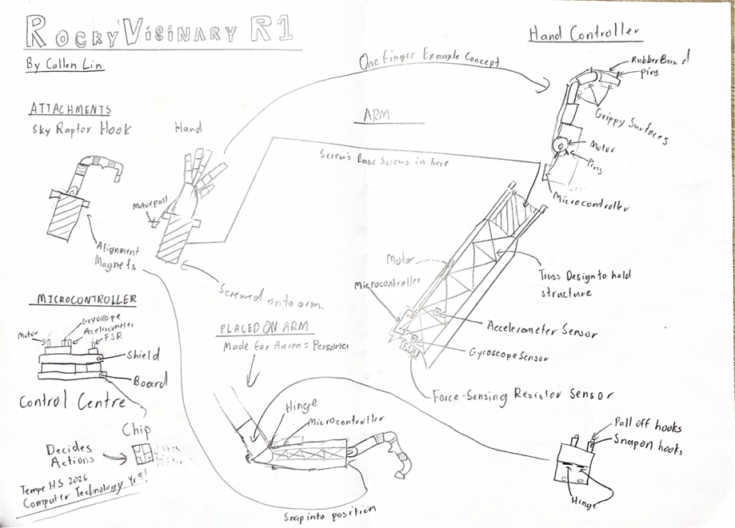

# Biomedical Project

> [!IMPORTANT]
> The project is currently in demo testing stages, and content below are subject to change.

## Overview of Project

> [!NOTE]
> Content from Statement of Intent in Biomedical Project Folio.

RockyVisionary is a biomedical mechanical arm that allows the user to control a prosthetic hand that follows the movement of the elbow. It uses a microcontroller, gyroscope, accelerometer, and motors to detect movement and translate it into controlled actions of the hand. Together, these components aim to create a comfortable and lightweight mechanical arm that responds naturally to the user’s movements.

RockyVisionary is a solution dedicated to Aaron, who envisions a future where he can pursue his passion for rock climbing again. Due to an unfortunate incident that resulted in a trans-radial amputation of his right arm, Aaron is no longer able to rock climb in the same way as before. However, because his elbow joint remains healthy, meaning there is still movement that can be used to help control the prosthetic arm.

Given that Aaron has a trans-radial amputation but still has a healthy elbow joint, RockyVisionary can use a range of sensors to detect the direction and rotation of his remaining arm. This information can then be processed by the microcontroller to determine how the prosthetic hand should respond. By using the movement Aaron still has, the device aims to provide him with a more natural way of controlling the hand and regaining some of the gripping ability required for rock climbing.

RockyVisionary will help Aaron work towards fulfilling his goal of rock climbing again, while also rebuilding his confidence and independence. By allowing him to regain some of the movement and gripping ability he lost, the device gives him the opportunity to return to an activity that is an important part of his life. RockyVisionary represents the idea that a physical setback does not necessarily have to prevent someone from continuing to pursue the goals that matter to them.

## Profile of Patient

## High Level Pictorial

> [!WARNING]
> This is subject to change, and image attached is the first iteration.

_High Level Pictorial of RockyVisionary R1:_

## Components

> [!NOTE]
> This is subject to change because the Force Sensitive Sensor (FSR) is not available.

- Force Sensitive Resistor (not available)
- Gyroscope
- 6-axis Accelerometer
